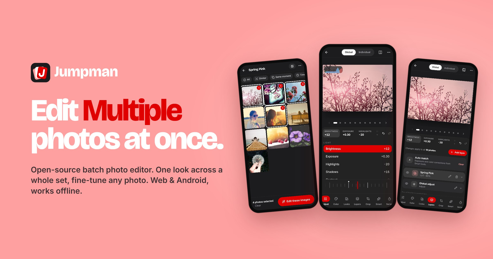
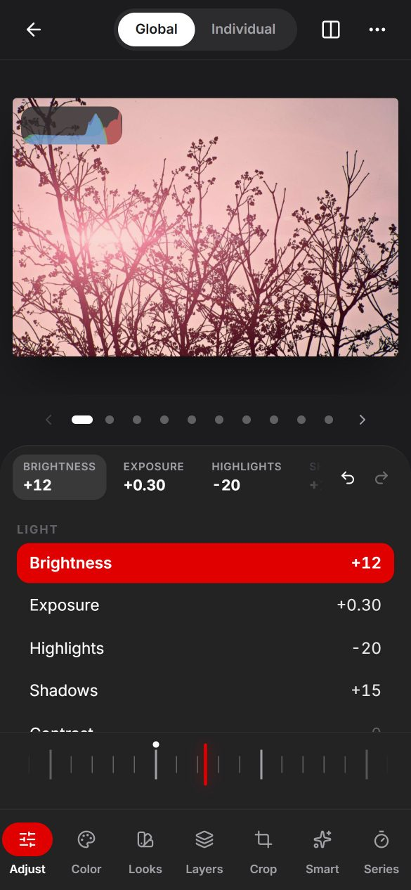
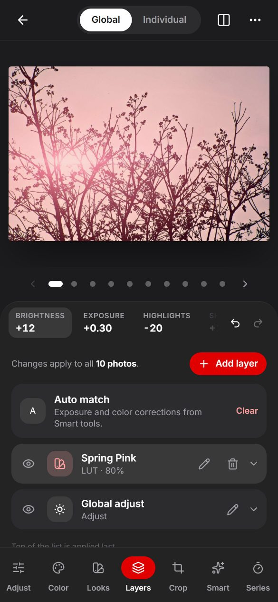
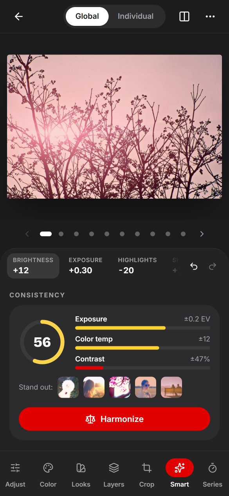
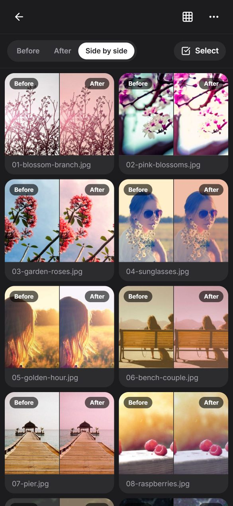
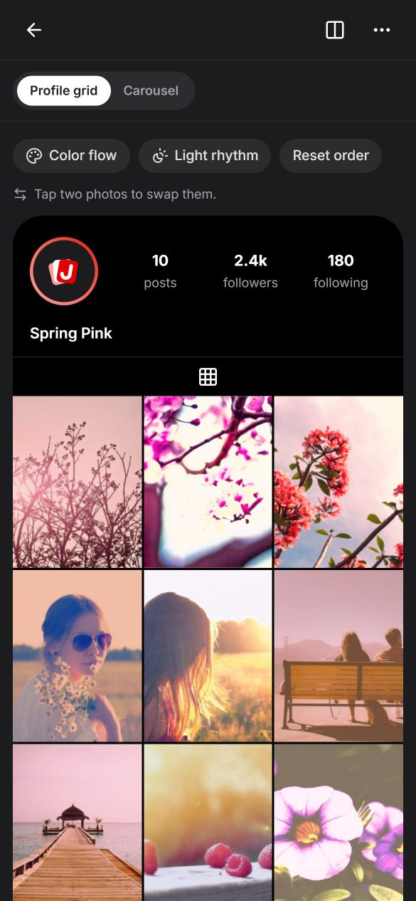
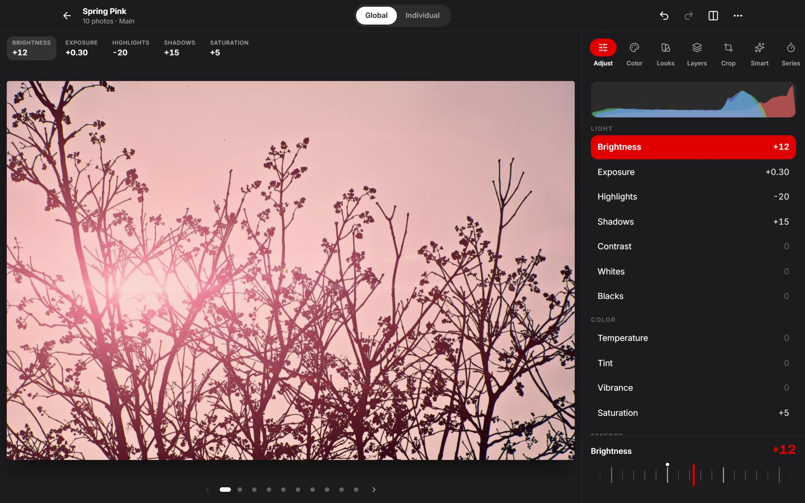

<div align="center">

<a href="https://fzn0x.github.io/jumpman/"></a>

### Edit **multiple** photos at once.

The open-source batch photo editor for web and Android: one consistent look across a whole set,<br>
per-photo control whenever you need it. Offline-first, no account, your photos never leave your device.

[](https://github.com/fzn0x/jumpman/actions/workflows/ci.yml)
[](https://github.com/fzn0x/jumpman/releases/latest)
[](./LICENSE)
[](https://fzn0x.github.io/jumpman/app/)
[](https://www.typescriptlang.org/)

**[Website](https://fzn0x.github.io/jumpman/)** ·
**[Open the web app](https://fzn0x.github.io/jumpman/app/)** ·
**[Download for Android](https://github.com/fzn0x/jumpman/releases/latest)** ·
**[Community presets](https://fzn0x.github.io/jumpman/presets/)**

<br>



</div>

## Why Jumpman?

Most editors are built for one photo at a time. Real shoots come in sets: a wedding, a trip, a product
drop, a carousel post. Jumpman treats the **batch** as the unit of work:

1. **Collect** photos into a collection (for example “Spring Pink”).
2. **Select** the ones that belong together, by tapping or with smart selection.
3. **Edit these images** together with one global edit, then fine-tune any single photo without breaking the set.

<table>
  <tr>
    <td></td>
    <td></td>
    <td></td>
    <td></td>
    <td></td>
  </tr>
  <tr>
    <td align="center">Adjust</td>
    <td align="center">Layers</td>
    <td align="center">Smart tools</td>
    <td align="center">Before / after</td>
    <td align="center">Instagram preview</td>
  </tr>
</table>



## Features

### Batch editing

| | |
| --- | --- |
| **Collections** | Group photos into collections, multi-select from the grid, then **Edit these images**. |
| **Global edit** | One shared adjustment set for the whole selection, with a summary bar for brightness, exposure, highlights, shadows and saturation. |
| **Global vs Individual** | Toggle between editing everything together and fine-tuning a single photo. The dot indicator flips between images. Individual tweaks are stored as offsets, so later global changes still apply. |
| **Layers** | Stack Adjust, LUT, Curves, HSL and Split toning layers. Edit, hide, reorder, duplicate, set opacity or delete them. |
| **Adjustment panel** | Brightness, exposure, highlights, shadows, contrast, whites, blacks, temperature, tint, vibrance, saturation, fade, vignette and grain on a dial-style slider, with a live RGB histogram and before/after compare (hold, or a draggable split). |

### Pro workflow

| | |
| --- | --- |
| **Presets (recipes)** | Save any global edit as a preset. Share it as a link or a file; custom LUTs are embedded. |
| **Copy / paste edits** | Copy one photo's edit and paste it onto all others or onto a selection. |
| **Auto-match exposure & white balance** | Normalize a mixed-lighting batch before the look is applied. |
| **Smart selection** | Select by visual similarity, the same moment (burst), a time range, scene type (landscape, portrait, foliage, night, architecture, golden light) or a color from the batch palette. |
| **Per-photo override indicator** | See which photos deviate from the global edit and reset them with one tap. |
| **Batch before/after grid** | Before, after or side by side for the whole selection. |
| **Masks & local adjustments** | Radial, linear, brightness range and color range masks, plus sky and subject masks that adapt to each photo. Any layer can be masked. |
| **Bulk crop** | 1:1, 4:5, 3:4, 9:16, 2:3, 16:9 and more for the whole set, with per-photo reposition, zoom, rotate and flip. |
| **Batch export** | Resize, JPEG/PNG/WebP/AVIF, quality, watermark, filename patterns (`{collection}-{n:3}`), ZIP download, save to a folder, or the share sheet. Saves to Documents/Jumpman on Android. |
| **Non-destructive history** | Per-batch undo/redo that survives reloads, and revert-to-original for a batch or a whole collection. |
| **Advanced color** | Monotone tone curves (RGB + per channel), 8-band HSL, split toning and a library of 15 built-in LUTs with live previews on your photo. Import and export `.cube`. |
| **RAW & XMP** | Opens DNG, CR2, CR3, NEF, ARW, RAF, ORF, RW2 and more through their embedded full-size previews. Imports and exports Lightroom/Camera Raw XMP (single presets or per-photo sidecars) and imports Capture One styles. |

### Only in Jumpman

| | |
| --- | --- |
| **Reference-match** | Pick a hero photo and the rest of the batch matches its tone and color. |
| **Edit from a sample image** | Drop in any photo, such as a film still or a magazine shot, and get a LUT that approximates its look (Oklab color transfer). |
| **Consistency score** | A per-batch readout of how uniform exposure, color temperature and contrast are, with a **Harmonize** button. |
| **Adaptive global edits** | Exposure acts as a target, not an offset: +0.6 means “bring everything to this brightness”. |
| **Edit by description** | Type “warmer, softer highlights, slightly faded” and get layers you can still tweak. Works offline: a phrase parser with more than 400 phrases, intensity words and negation. |
| **Scene-aware auto edit** | Detects sky, skin, foliage and architecture and adds tuned layers for each region. |
| **Series mode** | Deflicker time-lapses, and build a gradual look shift from the first photo to the last. |
| **Community presets** | Browse presets shared through GitHub, preview them on your own batch, save or fork (remix) them. |
| **Version branches** | Keep alternate looks, like “warm” and “moody”, for the same batch and compare them side by side. |
| **Edit replay** | Record an editing session as steps and replay it on another batch, like a macro. Smart tools re-run on the new photos. |
| **Collaborative review** | Send a review file (with previews). Clients comment, approve and suggest edits that come back as proposed layers you accept or reject. No server needed. |
| **Platform-aware export** | Preview the batch as an Instagram profile grid or carousel, reorder by color flow or light rhythm, then export at 1080×1350 / 1080×1440. |
| **Offline-first** | An installable PWA. Photos, edits, presets and history live in IndexedDB on your device. |

### Roadmap

- End-to-end encrypted cloud sync across devices
- Real-time collaboration
- On-device AI segmentation masks and brush masks
- Full RAW decoding (LibRaw in WebAssembly)
- Publishing presets to the community gallery from inside the app

## Install

### Web app (any device)

Open **https://fzn0x.github.io/jumpman/app/** in a recent Chrome, Edge, Firefox or Safari. Jumpman runs
entirely in your browser and needs WebGL2.

To install it as an app, use **Install app** in the address bar (desktop Chrome/Edge) or
**Add to Home screen** from the browser menu (Android). After the first visit it also works offline.

### Android

1. Open the [latest release](https://github.com/fzn0x/jumpman/releases/latest) on your phone.
2. Download `jumpman-android-vX.Y.Z.apk`.
3. Open the file. If Android asks, allow your browser or file manager to install unknown apps.
4. Launch **Jumpman**. Exports are saved to `Documents/Jumpman`.

You can check the download against `SHA256SUMS.txt` in the release.

### iPhone and iPad

Open the web app in **Safari**, tap **Share → Add to Home Screen**, then launch Jumpman from your home screen.

### Self-host

1. Download `jumpman-web-vX.Y.Z.zip` from the [latest release](https://github.com/fzn0x/jumpman/releases/latest).
2. Unzip it and serve the folder with any static web server, for example:

   ```sh
   npx serve jumpman-web
   ```

3. Use HTTPS (or `localhost`) so the offline mode and installability work.

### Build from source

Requires [Node.js](https://nodejs.org) 22.12+ and [pnpm](https://pnpm.io) 10.

```sh
git clone https://github.com/fzn0x/jumpman.git
cd jumpman
pnpm install
pnpm dev          # web app at http://localhost:5173
```

<details>
<summary>Build the Android app yourself</summary>

You need JDK 21 and the Android SDK (Android Studio installs both).

```sh
pnpm --filter @jumpman/web build:android            # build the web app and sync it into android/
cd apps/web/android && ./gradlew assembleDebug       # → app/build/outputs/apk/debug/app-debug.apk
# or open the project in Android Studio:
pnpm --filter @jumpman/web android
```

Release builds are signed in CI from repository secrets (`ANDROID_KEYSTORE_BASE64`,
`ANDROID_KEYSTORE_PASSWORD`, `ANDROID_KEY_ALIAS`, `ANDROID_KEY_PASSWORD`).
</details>

## Quick start

1. Tap **Try the Spring Pink samples** (or **Import photos**).
2. Tap **All**, or use **Similar**, **Same moment**, **Time**, **Scene** or a color dot to select photos.
3. Tap **Edit these images**.
4. Try **Smart → Auto-match**, then **Looks → Spring Pink**, then shape it with the **Adjust** dial.
5. Switch to **Individual** to fine-tune one photo; the dots show which photos differ.
6. **⋯ → Export…** to save a ZIP, or **⋯ → Instagram preview** to plan a grid.

Keyboard: `←`/`→` switch photos, `G` toggles Global/Individual, hold `\` for the original,
`Ctrl/⌘ Z` undo, `?` shows all shortcuts.

## File formats

| Format | Import | Export |
| --- | :---: | :---: |
| JPEG, PNG, WebP, AVIF (HEIC where the browser supports it) | ✅ | ✅ (HEIC: import only) |
| Camera RAW: DNG, CR2, CR3, NEF, ARW, RAF, ORF, RW2, PEF, SRW, … (embedded preview) | ✅ | — |
| Lightroom / Camera Raw `.xmp` (presets and sidecars) | ✅ | ✅ |
| Capture One `.costyle` / `.copreset` | ✅ | — |
| `.cube` 3D LUTs (and 1D) | ✅ | ✅ (bake your look into a LUT) |
| Jumpman presets `.jumpman-preset.json` and share links | ✅ | ✅ |
| Jumpman review files `.jumpman-review.json` | ✅ | ✅ |

## How it works

```
packages/core       Pure TypeScript engine, no DOM: edit model, ops reducer, color science,
                    reference CPU pipeline, analysis (auto-match, consistency, scenes, similarity),
                    presets, XMP/Capture One/.cube/RAW parsing, edit-by-description. 180+ tests.
packages/renderer   WebGL2 pipeline (one shader pass per layer, half-float targets, 3D LUT textures)
                    that mirrors the CPU pipeline; a browser test checks GPU vs CPU pixel parity.
apps/web            React 19 + React Compiler, Vite 8, Tailwind CSS 4, Zustand, IndexedDB, Web Workers,
                    vite-plugin-pwa, Capacitor 8 for Android.
apps/site           Astro 7 landing page and the community preset gallery (GitHub Pages).
community/presets   Presets contributed through pull requests.
```

Every edit is a serializable operation applied by a pure reducer. That one design gives Jumpman undo
history, copy/paste, macros (edit replay), version branches and collaborative suggestions.

Photos are decoded and analyzed off the main thread. Each photo gets a small statistics profile
(log-average exposure, gray-world color, contrast, palette, perceptual hash, scene scores and a salient
center), which drives auto-match, consistency, smart selection and scene-aware edits.

## Privacy

Jumpman has no backend. There are no accounts and no analytics, and nothing is uploaded. Photos and edits
are stored in your browser's IndexedDB (or the app's storage on Android). The only network requests are
loading the app itself and, if you open the Community tab, the public preset gallery.

## Contributing

Contributions are very welcome: code, docs, design feedback, bug reports and presets. Read
[CONTRIBUTING.md](./CONTRIBUTING.md) to get started. The project uses
[Conventional Commits](https://www.conventionalcommits.org) and small, focused commits. To share a look
with everyone, see [community/README.md](./community/README.md).

## Credits

- Sample photos from [Unsplash](https://unsplash.com) via [Lorem Picsum](https://picsum.photos), see
  [credits](apps/web/public/samples/CREDITS.md).
- [Bricolage Grotesque](https://github.com/ateliertriay/bricolage) and [Inter](https://rsms.me/inter/)
  under the SIL Open Font License; icons by [Lucide](https://lucide.dev).

## License

[MIT](./LICENSE) © fzn0x and Jumpman contributors.

<sub>Jumpman is an independent open-source project. It is not affiliated with or endorsed by any camera,
film, software or apparel brand.</sub>
